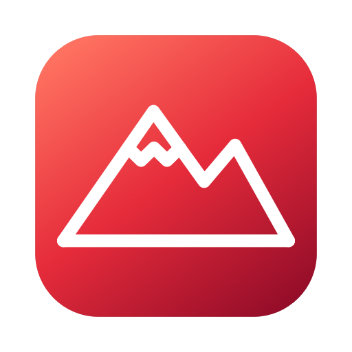
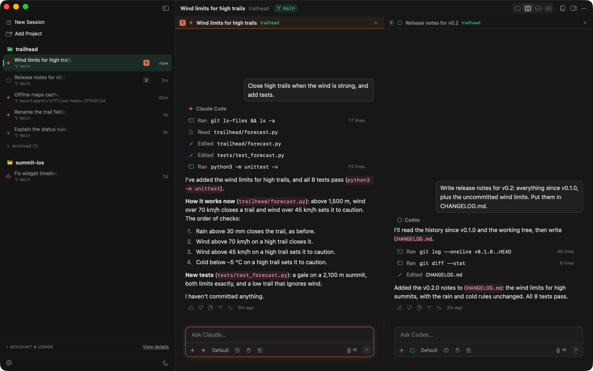
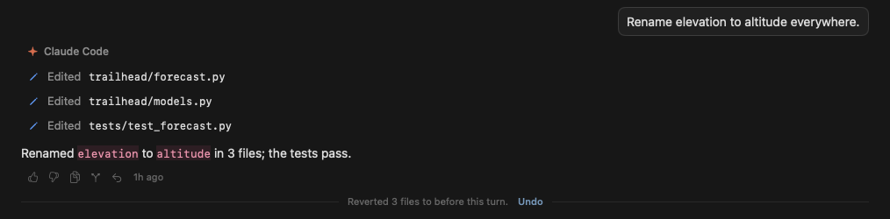
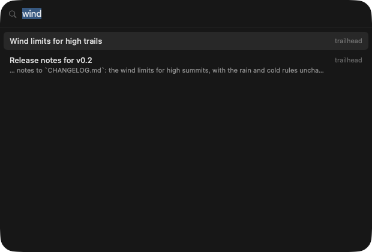
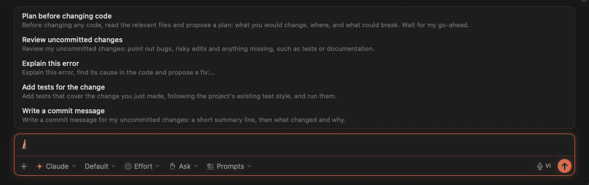
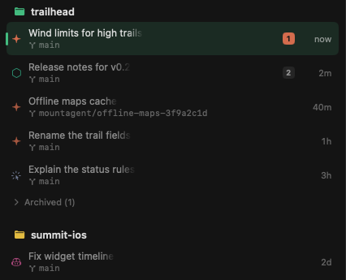
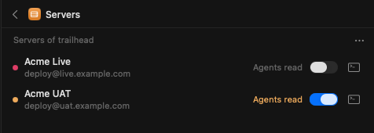
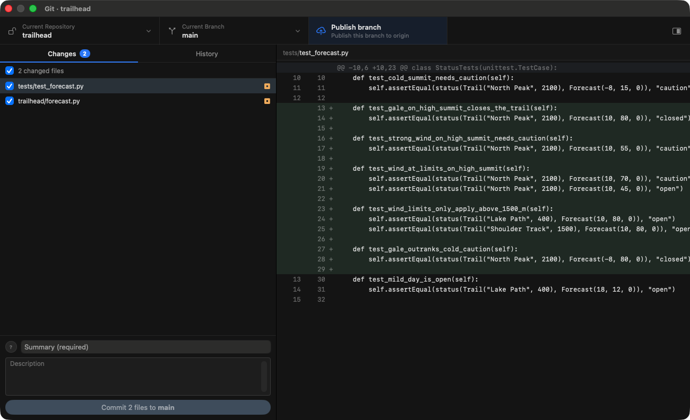

<p align="center">
  
</p>

<h1 align="center">Every agent. One desk.</h1>

<p align="center">
  
  
  
  
  
  
  
  <br />
  <sub>In their own terminal interface: Kiro · Amp · Kimi Code · Grok Build · Mistral Vibe · Droid · any CLI</sub>
</p>

<p align="center"><sub>🍎 Native macOS &nbsp;·&nbsp; 🆓 Free &nbsp;·&nbsp; 📖 MIT</sub></p>

<p align="center"><a href="#build"><b>Build it →</b></a></p>



<table>
  <tr>
    <td width="50%" valign="top"><h3>↩️ Undo any turn</h3></td>
    <td width="50%" valign="top"><h3>🔎 ⌘K to any session</h3></td>
  </tr>
  <tr>
    <td valign="top"><h3>💬 Prompts on <code>/</code></h3></td>
    <td valign="top"><h3>🌿 A worktree per session</h3></td>
  </tr>
  <tr>
    <td valign="top"><h3>🖥️ Servers, read-only for agents</h3></td>
    <td valign="top"><h3>🔀 Git built in</h3></td>
  </tr>
</table>

<p align="center">
  ✋ Approve commands &nbsp;·&nbsp; ⏳ Queue messages &nbsp;·&nbsp; 💵 Cost per project<br />
  🗂️ Archive &amp; export &nbsp;·&nbsp; 💾 Backup &amp; restore &nbsp;·&nbsp; 🎙️ Dictation
</p>

<a id="build"></a>

## 🛠️ Build

```sh
brew install xcodegen
scripts/make-signing-cert.sh   # once
scripts/build-app.sh           # installs /Applications/Mountagent Desk.app
```

<sub>macOS 14+ · Xcode 16+ · sign in to each agent CLI once · <a href="ARCHITECTURE.md">How it works</a> · <a href="LICENSE">MIT</a> · Copilot mark from <a href="https://github.com/primer/octicons">Primer Octicons</a> (MIT)</sub>
