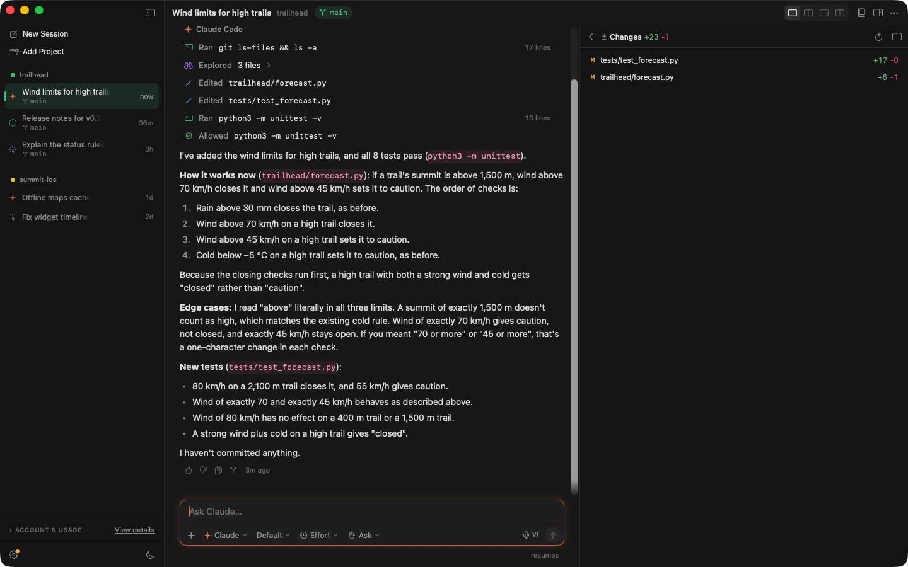
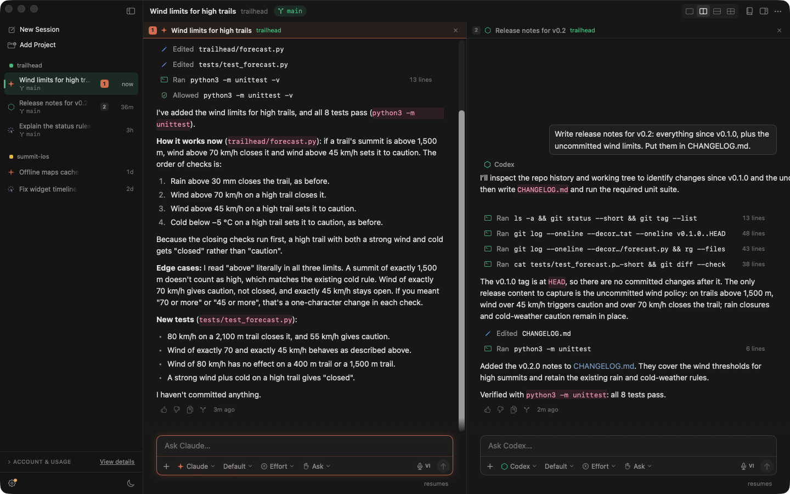
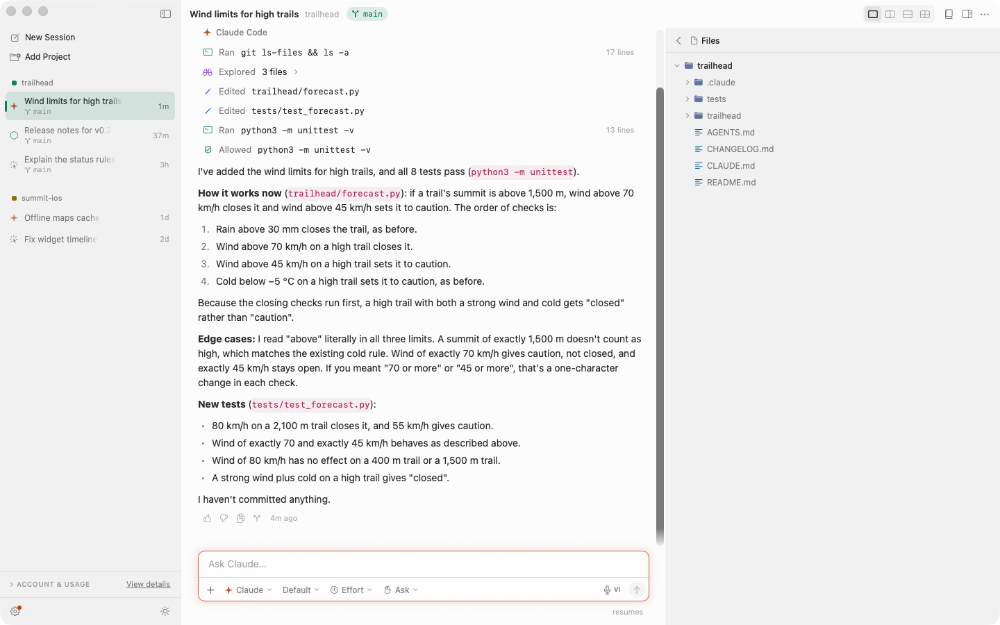

<p align="center">
  
</p>

<h1 align="center">Mountagent Desk</h1>

<p align="center">
  <a href="LICENSE"></a>
  
  
  
</p>

<h2 align="center">Every coding agent, in one native Mac window.</h2>

<p align="center">
  Chat with Claude Code, Cursor, Codex and Antigravity side by side. Switch agents between
  messages, approve their commands like in the IDEs, and review the changes and Git history
  without leaving the conversation.
</p>

<p align="center">
  <strong><a href="#build-and-run">Build Mountagent Desk →</a></strong>
</p>



## The loop

|             |                                                                                                                  |
| ----------- | ---------------------------------------------------------------------------------------------------------------- |
| **Ask**     | Add a project folder, open a session and pick the agent, model, effort and access for it.                         |
| **Approve** | The agents edit files freely and ask before they run commands or MCP tools. Allow once, always, or deny.        |
| **Review**  | See what changed in the side panel, with a diff per file, then commit and push from the Git workspace.          |
| **Switch**  | Hand the same session to another agent. It is told what happened while it was away and picks up from there.    |

Nothing is locked in: rules, skills and MCP config stay in each tool's own files in the
project, so they keep working in Cursor, in the `claude` terminal and in Codex too.

## What it does

### Four agents, one conversation

Each session is a separate conversation with its own transcript, and several can run at
once. Pick the agent for every message:

- **Claude Code** (`claude`) and **Cursor** (`cursor-agent`) stream their replies,
  thinking and tool calls as they work.
- **Codex** (`codex exec`) and **Antigravity** (`agy`) run headless; their access maps
  onto their own sandbox and permission modes.

When you switch, the next agent is handed the turns it missed, and each agent resumes its
own CLI session (`--resume`). Under each reply you can rate it, copy it, or **fork** the
session from that point.

Split the chat area into two or four panes to keep several sessions in view:



### Approvals like in the IDEs

In *Ask for commands* mode the agents edit files freely and ask before running commands or
MCP tools.

- **Claude** waits in the chat until you choose **Allow**, **Always Allow** or **Deny**.
  Always Allow saves the rule to `.claude/settings.local.json`, the same as Claude Code's
  "don't ask again".
- **Cursor** can't wait when it runs headless, so a call it isn't allowed to make is
  blocked. Choose **Allow Once & Retry** or **Always Allow & Retry**: Mountagent Desk adds
  `Mcp(server:tool)` or `Shell(command)` to `.cursor/cli.json` and resumes Cursor's session
  so it retries the step. A rule allowed once is removed again after the retry.

Access per session is *Read only* (plan mode), *Ask for commands* or *Full access*.

### A side panel for the work around the chat

Open it with ⌥⌘I, under "On ‹branch›":

- **Changes**: uncommitted changes against HEAD, untracked files included, each with +/−
  counts and a colored diff. It refreshes after every turn.
- **Git**: the Git workspace below, inside the panel.
- **Browser**: an embedded web view, for example for `localhost:8069`.
- **Terminal**: a real login shell in the project folder, built on
  [SwiftTerm](https://github.com/migueldeicaza/SwiftTerm).
- **Files**: the project's folders as a tree, with a preview. Mention a file in the message
  or open it in Cursor from there.

### Git, laid out like GitHub Desktop


Open it from the side panel or in its own window with ⇧⌘G.

- **Changes**: tick the files to commit, read each diff with line numbers, write a summary
  and description, and press **Commit to ‹branch›**. Discard, ignore or open a file from
  its context menu; stashes show a Restore / Discard bar.
- **History**: browse any branch. Cherry-pick, revert, branch from, reset (with a
  confirmation), check out or copy a commit.
- **Branches and sync**: a filterable branch list, and one button that becomes Fetch,
  Pull ↓n, Push ↑n or Publish branch as needed. Switching with uncommitted changes offers
  to stash them or bring them along.
- **Conflicts** from a pull or cherry-pick show a banner with Open in Cursor, Abort and
  Continue. Continue refuses while conflict markers remain.
- **Writes pause** while an agent is running in that repository.

### A Git account per project

In Settings → Git, keep several accounts, each with a name, an email and an SSH key.
**Connect with GitHub…** signs in through GitHub's CLI, fills in the verified email,
creates an SSH key and adds it to GitHub. Choose the account in **Folders & Name**, and
Mountagent Desk writes `user.name`, `user.email` and `core.sshCommand` into every
repository of the project, so agents, terminals, Cursor and Sourcetree all commit and push
as that account.

### Accounts and usage

The sidebar shows, per agent, whether its CLI is installed and signed in, the account and
plan, and the CLI version with an **Update** button. For Claude it also shows the 5-hour
and weekly plan limits with their reset times; for every agent, the tokens and cost spent
through Mountagent Desk over today, 7 days and 30 days. A missing or signed-out CLI gets an
**Install & Sign In…** banner that runs the official installer and sign-in in a terminal
sheet.

### Projects with more than one folder

Select several folders when you add a project. The agents run in the main folder and get
the others with `--add-dir`. Optionally the rules in the other folders are loaded too:
Claude reads their `CLAUDE.md`, and Cursor, which ignores rules outside its workspace, is
sent their `AGENTS.md` (or `CLAUDE.md`) with the first message of a new session.

### Rules & Skills editor

Edit the project's agent files in one place (⇧⌘K):

- `AGENTS.md` for every agent (Claude reads it through `@AGENTS.md` in `CLAUDE.md`)
- `CLAUDE.md` and `.claude/rules/*.md`
- `.cursor/rules/*.mdc`
- skills in `.claude/skills/<name>/SKILL.md`
- `.mcp.json` and `.cursor/mcp.json`

The agents are told the session title, so a skill that reads a ticket id from the chat
title works with a bare `sync`. An agent can rename the session too: when it ends a reply
with a line `Mountagent-Title: <title>`, Mountagent Desk renames the session and hides that
line.

### Native, in Light and Dark



Switch with **View → Appearance**, the toolbar's **⋯** menu, or Settings. The design
follows Cursor's Agents window: one ink color per appearance, a flat sidebar, 40pt top
bars, and a single 720pt transcript column where replies have no bubble and tool calls
are compact lines. Replies stream as Markdown with copyable code blocks and collapsible
thinking, each turn shows its duration, tokens and cost, and you get a notification when a
background session finishes. You can also dictate a message.

## Build and run

Requirements:

- macOS 14 or later, and Xcode 16 or later
- [XcodeGen](https://github.com/yonaskolb/XcodeGen): `brew install xcodegen`
- network access on the first build, so Swift Package Manager can fetch SwiftTerm (in
  Xcode, choose **Trust & Enable** for its build plugin)
- the agent CLIs you want to use, each signed in once in Terminal: `claude`,
  `cursor-agent login`, `codex login`, `agy`. Mountagent Desk finds them through your
  login shell's `PATH`; set other locations in **Settings → Paths**.

```sh
scripts/make-signing-cert.sh       # once: a local signing certificate
scripts/build-app.sh               # Release, installed as /Applications/Mountagent Desk.app
open "/Applications/Mountagent Desk.app"
```

The local certificate, "Mountagent Desk Local Signing", gives every build the same
signature, so macOS remembers "Always Allow" answers such as keychain access. The first
build asks you to let `codesign` use the key; choose **Always Allow**. Debug builds
(`CONFIGURATION=Debug scripts/build-app.sh`) go to `build/Debug.noindex/` and never
replace the installed app.

To work in Xcode, run `xcodegen generate && open MountagentDesk.xcodeproj`. The project file
is generated and not committed.

### Coming from AgentDesk

Mountagent Desk was called AgentDesk. On its first launch it moves
`~/Library/Application Support/AgentDesk` to `~/Library/Application Support/Mountagent Desk`
(leaving a link at the old path) and copies the settings of `dev.agentdesk.AgentDesk`.
Skills that end a reply with `AgentDesk-Title:` still rename the session. macOS asks again
for the microphone and keychain, since the bundle id changed. Delete
`/Applications/AgentDesk.app` once the new app works.

## Tests

```sh
cd Packages/MountagentDeskKit
swift test                                            # parsers, transcript, store, context files, git
MOUNTAGENT_LIVE=1 swift test --filter LiveAgentTests  # real CLIs: handoff, resume, stop
```

The parser tests replay `stream-json` output recorded from the real CLIs, kept in
`Tests/MountagentDeskKitTests/Fixtures`. [ARCHITECTURE.md](ARCHITECTURE.md) explains how
the app and the package fit together.

## Distribution

Mountagent Desk launches other programs and opens any folder, so it is not sandboxed,
which rules out the Mac App Store. Ship it with a Developer ID signature, the hardened
runtime (already on) and notarization:

```sh
xcrun notarytool store-credentials mountagent-notary --apple-id you@example.com --team-id TEAMID
DEVELOPER_ID="Developer ID Application: Your Name (TEAMID)" TEAM_ID=TEAMID scripts/build-app.sh
NOTARY_PROFILE=mountagent-notary scripts/release.sh   # → build/MountagentDesk-<version>.dmg, notarized and stapled
```

Each user signs in to their own agent accounts. Check each provider's terms before you ship
this to other people.

## Debug hooks

Debug builds read a few environment variables, so a script can drive the app (the
screenshots above were taken this way):

| Variable | Effect |
| --- | --- |
| `MOUNTAGENT_DATA_DIR` | Use this folder for data instead of `~/Library/Application Support/Mountagent Desk` |
| `MOUNTAGENT_AUTOSEND` | Send this prompt to the selected session when the app launches |
| `MOUNTAGENT_SNAPSHOT` | Write `<value>-window<n>.png` of each window and `<value>-transcript.png` of the selected session |
| `MOUNTAGENT_SNAPSHOT_DELAY` | Seconds to wait before the snapshot (default 3) |

```sh
open -n "build/Debug.noindex/Mountagent Desk.app" --env MOUNTAGENT_DATA_DIR=/tmp/md --env MOUNTAGENT_AUTOSEND="hi"
```

`MOUNTAGENT_DATA_DIR` is the only one of these that Release builds also read.

## License

[MIT](LICENSE)
